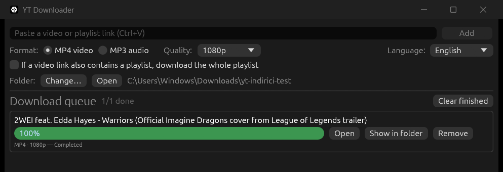

# YT İndirici

A small, fast-starting Windows desktop app for downloading YouTube videos as MP4 or audio as MP3, built on top of `yt-dlp`.

"YT İndirici" is Turkish for "YT Downloader". [Türkçe açıklama aşağıda.](#türkçe)



## Features

- Paste one or several video or playlist links at once (separated by spaces or new lines).
- MP4 video: Best / 2160p / 1440p / 1080p / 720p / 480p / 360p. At equal resolution H.264 + AAC is preferred, since it works best in video editors. Above 1080p YouTube only offers VP9/AV1.
- MP3 audio: 320 / 256 / 192 / 128 kbps.
- Optionally download the whole playlist when a video link also contains `list=`. Playlist and channel links are expanded into individual queue items.
- Output folder (default `%USERPROFILE%\Downloads`) can be changed and is remembered.
- Download queue with title, progress, speed, ETA and status; up to 2 downloads run in parallel.
- Cancel, retry, open file, show in folder, remove from queue.
- Cancelling stops the whole yt-dlp process tree (including ffmpeg) through a Windows Job Object. Closing the app also stops anything left over, and asks for confirmation first if downloads are still running.
- Single instance: launching it a second time brings the existing window to the front instead of opening a new one.
- UI languages: Türkçe, English, Deutsch, Español, Русский, 简体中文. Defaults to the Windows UI language and can be switched in the app.
- CJK video titles are rendered with the system's Microsoft YaHei / Malgun Gothic fonts, loaded in the background after startup.
- Starts quickly: about 0.3 s to a visible window with the first frame drawn on the author's PC (Tyrrrz/YoutubeDownloader took about 1.9 s warm on the same machine).

Not included: account login / cookies, subtitles, tag editing, auto-update, themes.

## Requirements

- Windows 10 or 11 (64-bit).
- [`yt-dlp.exe`](https://github.com/yt-dlp/yt-dlp/releases) — looked up next to `yt-indirici.exe` first, then on `PATH`. It does all the downloading and stream extraction.
- `ffmpeg` on `PATH` — used for merging video and audio and for MP3 conversion. Install it separately.
- Optional: Node.js. If `node.exe` is on `PATH`, the app passes `--js-runtimes node:<path>` to yt-dlp. YouTube now requires a JavaScript runtime, and yt-dlp only enables Deno by default.

## Install and usage

1. Download `yt-indirici.exe` from [Releases](https://github.com/01burark-oss/yt-indirici/releases), or build it yourself (see below).
2. Put `yt-dlp.exe` in the same folder and make sure `ffmpeg` is on `PATH`.
3. Run `yt-indirici.exe`, paste one or more links, choose MP4 or MP3 and the quality, and start the download.

The release binary is not code-signed, so Windows SmartScreen or Smart App Control may show a warning.

To update yt-dlp (YouTube changes often and old versions stop working), run `yt-dlp.exe -U` in the app folder.

Settings are stored in `%APPDATA%\YtIndirici\ayarlar.json`.

## Command line

```
yt-indirici.exe <url> [<url>...] [--mp3|--mp4]
```

Adds the given links to the queue at startup. `--mp3` / `--mp4` applies only to those links. If the app is already running, the existing window is brought to the front and the links are not passed on to it.

## Building

Requires a Rust toolchain. With the MSVC toolchain (recommended) it builds out of the box:

```
cargo build --release
```

The result is `target\release\yt-indirici.exe`.

### GNU toolchain

With `x86_64-pc-windows-gnu`, `windows-sys` 0.61 / `windows-link` use `raw-dylib` imports, which need GNU `dlltool.exe` **and** GNU `as.exe` on `PATH`, in the same folder (for example from a MinGW-w64 / WinLibs binutils). rustup's GNU toolchain ships `dlltool` in `lib\rustlib\x86_64-pc-windows-gnu\bin\self-contained` but no `as.exe`, and `dlltool` only looks for `as` next to itself.

`derle.ps1` is the author's build script for this setup:

```
powershell -ExecutionPolicy Bypass -File derle.ps1 [-AraclarKlasoru <folder>] [-Kur] [-KurulumKlasoru <folder>]
```

- `-AraclarKlasoru`: folder containing `dlltool.exe` + `as.exe`; it is put in front of `PATH` if it exists. Defaults to `$env:YTI_MINGW_AS`, then to the author's own path.
- Builds with low process priority and half the CPU cores.
- `-Kur` copies `target\debug\yt-indirici.exe` to the install folder (`-KurulumKlasoru`).

### Smart App Control note

On machines with Windows Smart App Control (SAC) enabled, SAC may block the unsigned build-script executables that Cargo compiles and runs during the build (`os error 4551`). On the author's machine some release-profile build scripts were blocked on every attempt while the dev-profile ones were allowed. As a workaround, `Cargo.toml` sets `[profile.dev] opt-level = 3` and `[profile.dev.package.yt-indirici-rs] strip = "debuginfo"`, so a plain `cargo build` produces an optimized `target\debug\yt-indirici.exe` while reusing build scripts SAC already allowed.

Do not change `debug`, `debug-assertions` or `overflow-checks` in the dev profile and do not add `rustflags`: that changes the build-script / proc-macro hashes and SAC blocks the new ones. Without SAC, `cargo build --release` (LTO + strip) works normally.

### Startup measurement

If started with the environment variable `YTI_OLCUM=<file>`, the app writes the process age in milliseconds at the first frame to that file.

## Credits

- [yt-dlp](https://github.com/yt-dlp/yt-dlp) (Unlicense) — downloading and stream extraction, run as a separate process.
- [FFmpeg](https://ffmpeg.org/) — merging and audio conversion; installed separately.
- [egui / eframe](https://github.com/emilk/egui) (MIT / Apache-2.0) — user interface.
- Inspired by [Tyrrrz/YoutubeDownloader](https://github.com/Tyrrrz/YoutubeDownloader), but shares no code with it.

## License

[MIT](LICENSE)

---

## Türkçe

YouTube videolarını MP4, seslerini MP3 olarak indirmek için küçük ve hızlı açılan bir Windows masaüstü uygulaması. İndirme işini `yt-dlp` yapar.

### Özellikler

- Bir ya da birden çok video veya oynatma listesi bağlantısı aynı anda yapıştırılabilir (boşluk ya da satırla ayrılmış).
- MP4 video: En iyi / 2160p / 1440p / 1080p / 720p / 480p / 360p. Aynı çözünürlükte, kurgu programlarıyla en uyumlu olan H.264 + AAC tercih edilir. 1080p'nin üstünde YouTube yalnızca VP9/AV1 sunar.
- MP3 ses: 320 / 256 / 192 / 128 kbps.
- Video bağlantısında `list=` da varsa isteğe bağlı olarak tüm oynatma listesi indirilebilir. Oynatma listesi ve kanal bağlantıları tek tek kuyruk öğelerine açılır.
- Kayıt klasörü (varsayılan `%USERPROFILE%\Downloads`) değiştirilebilir ve hatırlanır.
- Kuyruk: başlık, ilerleme, hız, kalan süre ve durum; aynı anda en fazla 2 indirme.
- İptal, tekrar dene, dosyayı aç, klasörde göster, kuyruktan kaldır.
- İptal, Windows iş nesnesi (Job Object) ile yt-dlp'nin tüm süreç ağacını (ffmpeg dahil) durdurur. Uygulama kapanınca yarım kalan süreçler de durdurulur; süren indirme varsa önce onay istenir.
- Tek kopya: ikinci kez açılırsa yeni pencere açılmaz, mevcut pencere öne gelir.
- Arayüz dilleri: Türkçe, English, Deutsch, Español, Русский, 简体中文. Varsayılan olarak Windows arayüz dili kullanılır, uygulama içinden değiştirilebilir.
- Çince/Japonca/Korece video başlıkları sistemdeki Microsoft YaHei / Malgun Gothic yazı tipleriyle gösterilir; bu yazı tipleri açılıştan sonra arka planda yüklenir.
- Hızlı açılış: yazarın bilgisayarında pencerenin görünüp ilk karenin çizilmesi yaklaşık 0,3 sn (aynı makinede Tyrrrz/YoutubeDownloader ikinci açılışta yaklaşık 1,9 sn).

Kapsam dışı: hesap girişi / çerezler, altyazı, etiket düzenleme, otomatik güncelleme, temalar.

### Gereksinimler

- Windows 10 ya da 11 (64 bit).
- [`yt-dlp.exe`](https://github.com/yt-dlp/yt-dlp/releases) — önce `yt-indirici.exe`'nin yanında, sonra `PATH`'te aranır. İndirme ve akış çıkarma işini o yapar.
- `PATH`'te `ffmpeg` — video ile sesi birleştirmek ve MP3'e dönüştürmek için. Ayrıca kurulmalıdır.
- İsteğe bağlı: Node.js. `node.exe` `PATH`'teyse yt-dlp'ye `--js-runtimes node:<yol>` verilir. YouTube artık bir JavaScript çalışma ortamı gerektiriyor ve yt-dlp varsayılan olarak yalnızca Deno'yu etkinleştiriyor.

### Kurulum ve kullanım

1. `yt-indirici.exe`'yi [Releases](https://github.com/01burark-oss/yt-indirici/releases) sayfasından indirin ya da kendiniz derleyin (aşağıya bakın).
2. `yt-dlp.exe`'yi aynı klasöre koyun ve `ffmpeg`'in `PATH`'te olduğundan emin olun.
3. `yt-indirici.exe`'yi çalıştırın, bir ya da daha çok bağlantı yapıştırın, MP4 ya da MP3 ile kaliteyi seçin ve indirmeyi başlatın.

Hazır exe kod imzalı değildir; Windows SmartScreen ya da Akıllı Uygulama Denetimi (Smart App Control) uyarı gösterebilir.

yt-dlp'yi güncellemek için (YouTube sık değişir, eski sürümler çalışmaz hale gelir) uygulama klasöründe `yt-dlp.exe -U` çalıştırın.

Ayarlar `%APPDATA%\YtIndirici\ayarlar.json` dosyasında tutulur.

### Komut satırı

```
yt-indirici.exe <bağlantı> [<bağlantı>...] [--mp3|--mp4]
```

Verilen bağlantıları açılışta kuyruğa ekler. `--mp3` / `--mp4` yalnızca bu bağlantılara uygulanır. Uygulama zaten açıksa mevcut pencere öne gelir ve bağlantılar ona aktarılmaz.

### Derleme

Rust araç zinciri gerekir. MSVC araç zinciriyle (önerilir) ek ayar gerekmeden derlenir:

```
cargo build --release
```

Çıktı: `target\release\yt-indirici.exe`.

#### GNU araç zinciri

`x86_64-pc-windows-gnu` ile `windows-sys` 0.61 / `windows-link` `raw-dylib` içe aktarmaları kullanır; bunun için `PATH`'te, aynı klasörde GNU `dlltool.exe` **ve** GNU `as.exe` gerekir (örneğin MinGW-w64 / WinLibs binutils'ten). rustup'ın GNU araç zinciri `dlltool`'u `lib\rustlib\x86_64-pc-windows-gnu\bin\self-contained` içinde getirir ama `as.exe` getirmez; `dlltool` da `as`'ı yalnızca kendi klasöründe arar.

`derle.ps1` yazarın bu kurulum için kullandığı derleme betiğidir:

```
powershell -ExecutionPolicy Bypass -File derle.ps1 [-AraclarKlasoru <klasör>] [-Kur] [-KurulumKlasoru <klasör>]
```

- `-AraclarKlasoru`: `dlltool.exe` + `as.exe` içeren klasör; varsa `PATH`'in başına eklenir. Varsayılanı `$env:YTI_MINGW_AS`, o da yoksa yazarın kendi yolu.
- Derleme düşük öncelikle ve işlemci çekirdeklerinin yarısıyla çalışır.
- `-Kur`, `target\debug\yt-indirici.exe`'yi kurulum klasörüne (`-KurulumKlasoru`) kopyalar.

#### Akıllı Uygulama Denetimi (Smart App Control) notu

Smart App Control (SAC) açık olan makinelerde SAC, Cargo'nun derleme sırasında üretip çalıştırdığı imzasız build script'lerini engelleyebilir (`os error 4551`). Yazarın makinesinde release profilinin build script'lerinin bir kısmı her denemede engellendi, dev profilininkilere ise izin verildi. Bu yüzden `Cargo.toml`'da `[profile.dev] opt-level = 3` ve `[profile.dev.package.yt-indirici-rs] strip = "debuginfo"` ayarlıdır: düz `cargo build`, SAC'ın daha önce izin verdiği build script'lerini yeniden kullanarak optimize edilmiş bir `target\debug\yt-indirici.exe` üretir.

Dev profilinde `debug`, `debug-assertions` ve `overflow-checks` değiştirilmemeli, `rustflags` eklenmemelidir: bunlar build script / proc-macro özetlerini değiştirir ve SAC yenilerini engeller. SAC kapalıysa `cargo build --release` (LTO + strip) normal çalışır.

#### Açılış ölçümü

Uygulama `YTI_OLCUM=<dosya>` ortam değişkeniyle başlatılırsa, ilk karede sürecin yaşını milisaniye olarak o dosyaya yazar.

### Teşekkürler

- [yt-dlp](https://github.com/yt-dlp/yt-dlp) (Unlicense) — indirme ve akış çıkarma; ayrı bir süreç olarak çalıştırılır.
- [FFmpeg](https://ffmpeg.org/) — birleştirme ve ses dönüştürme; ayrıca kurulur.
- [egui / eframe](https://github.com/emilk/egui) (MIT / Apache-2.0) — kullanıcı arayüzü.
- [Tyrrrz/YoutubeDownloader](https://github.com/Tyrrrz/YoutubeDownloader)'dan esinlenilmiştir, ancak onunla ortak kod içermez.

### Lisans

[MIT](LICENSE)
